 

  

## ✦ Sobre mí / About Me

<table>
<tr>
<td width="100%">

☁️ **Junior Consultant** en IANGEL SAS (AWS Partner): levantamiento de requerimientos, análisis AS-IS / TO-BE y apoyo en proyectos con clientes.
 
🎓 **Ingeniería de Sistemas** @ Universidad EAN (2024 – 2027).
 
⚛️ **Core team de [Elemental W](https://elementalw.site)**: plataforma web para aprender ciencias básicas. Coautora de la investigación presentada en el V EISI 2026.
 
🌌 Me gusta construir **experiencias web interactivas y en 3D**, como mi [portafolio-universo](https://dcoavas.com).
 
🗣️ Español (nativo) · English (C1) · Français (C1).

</td>
</tr>
</table>

<b>🐾 Más sobre mí / More about me</b> (click)

 

- 💼 Antes: **Frontend Developer** en WorkCango (React + Tailwind) y **Web Developer** en TechForge Solutions.
- 🧪 Bootcamp **Full Stack Development** — BIT Institute (2025).
- 📚 Ahora estudiando para **AWS Certified Machine Learning Engineer – Associate**.
- 🐱 El gatito morado del banner es mi mascota pixel.

## ⚛️ Elemental W

<table>
<tr>
<td width="60%" valign="top">

**Elemental W** es un aula digital para aprender **Física, Química y Cálculo** con clases, minijuegos y evaluaciones, y con herramientas para que los docentes entiendan mejor a su grupo. Nace del Semillero Smart Farming de la Universidad EAN.

Hago parte del **core team** del proyecto junto a su fundador, [Brian Pérez](https://github.com/BrianPerez22): soy la mano derecha en el desarrollo y en la investigación.

📄 **Coautora** de *“Criterios para la implementación de gamificación web en educación superior”* — póster en el **V EISI 2026** (Universidad EAN), estudio con 46 estudiantes y 4 docentes de Física Mecánica y Química General.

</td>
<td width="40%" valign="top" align="center">

 

 

`React` `TypeScript` `Tailwind CSS` `Vite`

</td>
</tr>
</table>

## 🌌 Proyectos destacados / Featured Projects

<table>
<tr>
<td width="50%" valign="top">

### 🪐 [Portafolio Universo](https://github.com/dannysophi17/portafolio-universo)

Mi portafolio como un pequeño universo 3D: cada planeta es una sección (About, Journey, Skills, Projects, Certifications, Contact).

`Next.js` `React Three Fiber` `Three.js` `AWS Amplify`

</td>
<td width="50%" valign="top">

### 🎁 [3D Memory Gift Template](https://github.com/dannysophi17/3d-memory-gift-template)

Plantilla open source para crear regalos interactivos en 3D con recuerdos personalizados.

`Next.js` `React Three Fiber` `Three.js` `Zustand`

</td>
</tr>
<tr>
<td width="50%" valign="top">

### 🚀 [Regalo Papá 3D](https://github.com/dannysophi17/regalo-papa-3d)

Aventura espacial interactiva en 3D hecha como regalo de cumpleaños.

`TypeScript` `Three.js` `React`

</td>
<td width="50%" valign="top">

### 🕹️ [Tareas Arcade](https://github.com/dannysophi17/Tareas-arcade-final)

App de tareas con estilo retro: frontend en Angular y backend propio con JWT, etiquetas, historial y estadísticas.

`Angular` `Node.js` `Express` `MongoDB`

</td>
</tr>
<tr>
<td width="50%" valign="top">

### 🔥 [GasCare Senior](https://github.com/dannysophi17/GasCare_Senior)

Sistema IoT para detectar fugas de gas en hogares con adultos mayores: ESP32 + backend PHP + dashboard.

`ESP32` `IoT` `PHP` `MySQL`

</td>
<td width="50%" valign="top">

### ☁️ [AWS Examples](https://github.com/dannysophi17/AWS-Examples)

Ejemplos y laboratorios que uso para estudiar las certificaciones de AWS.

`AWS` `Shell` `CLI`

</td>
</tr>
</table>

## 🏅 Certificaciones / Certifications

 

## ⚡ Stack

<table>
  <tr>
    <td align="center" width="120"> <b>AWS</b> </td>
    <td align="center" width="120"> <b>React</b> </td>
    <td align="center" width="120"> <b>Next.js</b> </td>
    <td align="center" width="120"> <b>Three.js</b> </td>
    <td align="center" width="120"> <b>TypeScript</b> </td>
    <td align="center" width="120"> <b>Node.js</b> </td>
  </tr>
</table>

 

## 📊 GitHub Stats

<b>📈 Ver actividad de contribuciones / Contribution activity</b>

 

 

<picture>
  <source media="(prefers-color-scheme: dark)" srcset="https://raw.githubusercontent.com/dannysophi17/dannysophi17/output/github-contribution-grid-snake-dark.svg" />
  <source media="(prefers-color-scheme: light)" srcset="https://raw.githubusercontent.com/dannysophi17/dannysophi17/output/github-contribution-grid-snake.svg" />
  
</picture>

 

