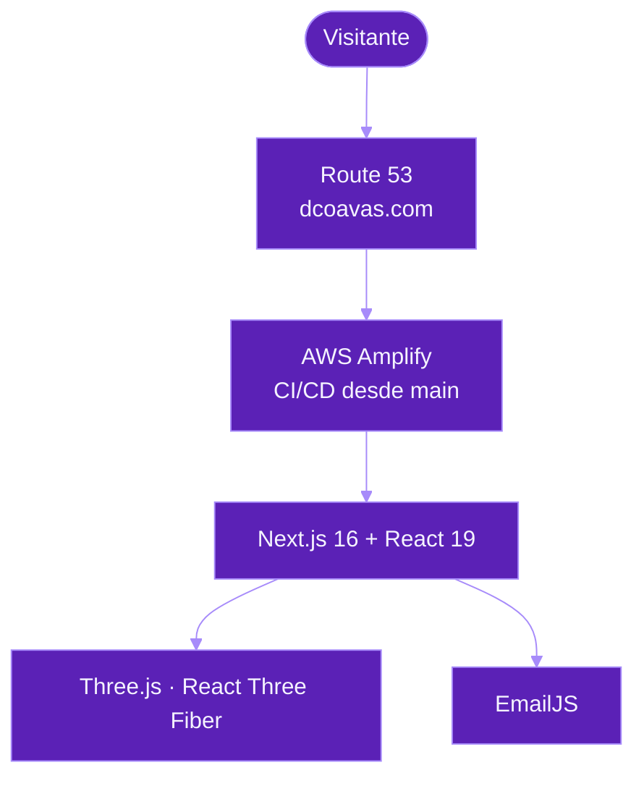

 

  

## 👩‍🚀 Hola, soy Daniela

- ☁️ **Junior Consultant** en IANGEL SAS (AWS Partner): requerimientos, análisis AS-IS / TO-BE y soluciones para clientes.
- 🎓 **Ingeniería de Sistemas** @ Universidad EAN.
- 🛰️ **Core team** del **AWS Student Builder Group (SBG)** de la Universidad EAN.
- 🔬 **Investigadora** en Elemental W, junto a Brian Pérez.
- 🗣️ Español · English (C1) · Français (C1).

  

## 🪐 Proyecto principal · Portafolio Universo

Mi portafolio es un **pequeño universo en 3D**: en vez de páginas, cada planeta es una sección (Sobre mí, Trayectoria, Skills, Proyectos, Certificaciones y Contacto). Lo diseñé, programé y desplegué yo, de punta a punta.

<table>
<tr>
<td width="50%" valign="top">

**Lo que construí**

- 🌌 Navegación 3D entre planetas con transiciones de cámara
- 📱 Responsive en computador, tablet y celular
- 🌐 Contenido bilingüe (ES / EN)
- 🖼️ Galerías de proyectos y demos en vivo
- ✉️ Formulario de contacto con EmailJS
- ✅ CI con GitHub Actions (ESLint, Prettier, TypeScript)

</td>
<td width="50%" valign="top">

**Cómo está desplegado en AWS**

</td>
</tr>
</table>

`Next.js 16` `React 19` `TypeScript` `Three.js` `React Three Fiber` `Tailwind CSS 4` `AWS Amplify` `Route 53` `GitHub Actions`

## ✨ Más proyectos

<table>
<tr>
<td width="50%" valign="top">

### 🎁 3D Memory Gift Template

Plantilla **open source** para crear regalos interactivos en 3D: estrellas de recuerdos, galerías de fotos, un regalo final que se desbloquea y soporte para modelos GLB, audio y video. Se personaliza solo con archivos de configuración.

`Next.js` `R3F` `Zustand` `Vitest` `MIT`

</td>
<td width="50%" valign="top">

### 🕹️ Tareas Arcade

App **full stack** de tareas con estilo retro. Frontend SPA en Angular con guards y JWT, y un backend propio con autenticación, etiquetas, historial de cambios y estadísticas por usuario.

`Angular` `Node.js` `Express` `MongoDB` `JWT`

</td>
</tr>
</table>

<b>🔥 GasCare Senior</b> · IoT para detectar fugas de gas (click)

 

Sistema para hogares con adultos mayores: un **ESP32** lee el sensor de gas y envía los datos por HTTP a un backend en **PHP**, que los guarda en **MySQL** y los muestra en un dashboard.

`ESP32` `IoT` `PHP` `MySQL` · [Ver repositorio](https://github.com/dannysophi17/GasCare_Senior)

<b>☁️ AWS Examples</b> · laboratorios para estudiar AWS (click)

 

Ejemplos y prácticas que uso para preparar mis certificaciones de AWS.

`AWS` `CLI` `Shell` · [Ver repositorio](https://github.com/dannysophi17/AWS-Examples)

## 🔬 Investigación

Investigadora en **[Elemental W](https://elementalw.site)**, una plataforma web para aprender ciencias básicas creada por [Brian Pérez](https://github.com/BrianPerez22). Junto a él presentamos el póster *“Criterios para la implementación de gamificación web en educación superior”* en el **V EISI 2026** (Universidad EAN).

## 🏅 Certificaciones

 

<b>📊 GitHub Stats</b> (click)

 

<picture>
  <source media="(prefers-color-scheme: dark)" srcset="https://raw.githubusercontent.com/dannysophi17/dannysophi17/output/github-contribution-grid-snake-dark.svg" />
  <source media="(prefers-color-scheme: light)" srcset="https://raw.githubusercontent.com/dannysophi17/dannysophi17/output/github-contribution-grid-snake.svg" />
  
</picture>

