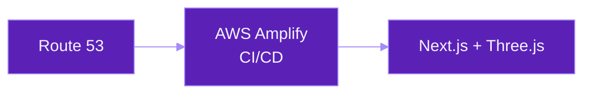

 

  

## Hi, I'm Daniela ✦

- **Junior Consultant** at IANGEL SAS (AWS Partner): requirements, AS-IS / TO-BE analysis and client solutions.
- **Systems Engineering** student at EAN University.
- **Core team** of the **AWS Student Builder Group (SBG)** at EAN University.
- **Developer and researcher** at Elemental W, with Brian Pérez.
- Spanish (native) · English (C1) · French (C1).

  

## 🪐 Main project · Portafolio Universo

My portfolio is a **small 3D universe**: instead of pages, each planet is a section (About, Journey, Skills, Projects, Certifications and Contact). I designed, built and deployed it end to end.

<table>
<tr>
<td width="50%" valign="top">

**Highlights**

- 3D planet navigation with camera transitions
- Responsive on desktop, tablet and mobile
- Bilingual content (ES / EN)
- CI with GitHub Actions (ESLint, Prettier, TypeScript)

</td>
<td width="50%" valign="top">

**Deployed on AWS**

</td>
</tr>
</table>

`Next.js 16` `React 19` `TypeScript` `Three.js` `React Three Fiber` `Tailwind CSS 4` `AWS Amplify` `Route 53`

## More projects

<table>
<tr>
<td width="50%" valign="top">

### 3D Memory Gift Template

**Open-source** template for interactive 3D gifts: memory stars, photo galleries, a final gift that unlocks, and support for GLB models, audio and video. Customized through config files only.

`Next.js` `R3F` `Zustand` `Vitest` `MIT`

</td>
<td width="50%" valign="top">

### Tareas Arcade

Retro-style **full stack** task app. Angular SPA with guards and JWT, plus my own backend with authentication, tags, change history and per-user stats.

`Angular` `Node.js` `Express` `MongoDB` `JWT`

</td>
</tr>
</table>

<b>GasCare Senior</b> · IoT gas leak detection (click)

 

A system for homes with older adults: an **ESP32** reads a gas sensor and sends the data over HTTP to a **PHP** backend, which stores it in **MySQL** and shows it on a dashboard.

`ESP32` `IoT` `PHP` `MySQL` · [View repository](https://github.com/dannysophi17/GasCare_Senior)

<b>AWS Examples</b> · labs for studying AWS (click)

 

Examples and practice labs I use to prepare for AWS certifications.

`AWS` `CLI` `Shell` · [View repository](https://github.com/dannysophi17/AWS-Examples)

## Research & development

**[Elemental W](https://elementalw.site)** is a web platform for learning physics, chemistry and calculus, started by [Brian Pérez](https://github.com/BrianPerez22). I build the platform with him as a developer and work on its research. Together we presented the poster *"Criteria for implementing web gamification in higher education"* at **V EISI 2026** (EAN University).

## Certifications & stack

 

<b>GitHub stats</b> (click)

 

<picture>
  <source media="(prefers-color-scheme: dark)" srcset="https://raw.githubusercontent.com/dannysophi17/dannysophi17/output/github-contribution-grid-snake-dark.svg" />
  <source media="(prefers-color-scheme: light)" srcset="https://raw.githubusercontent.com/dannysophi17/dannysophi17/output/github-contribution-grid-snake.svg" />
  
</picture>

